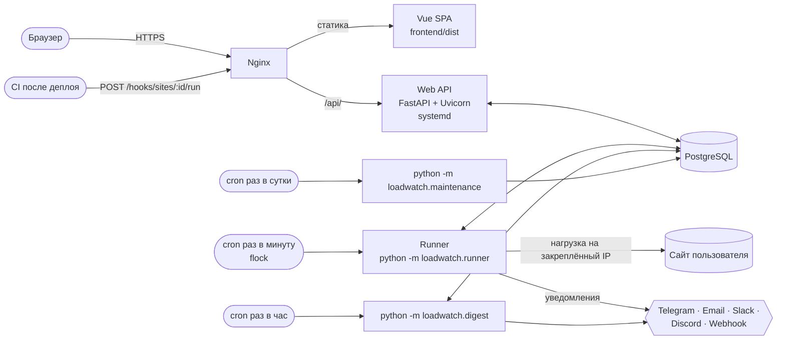
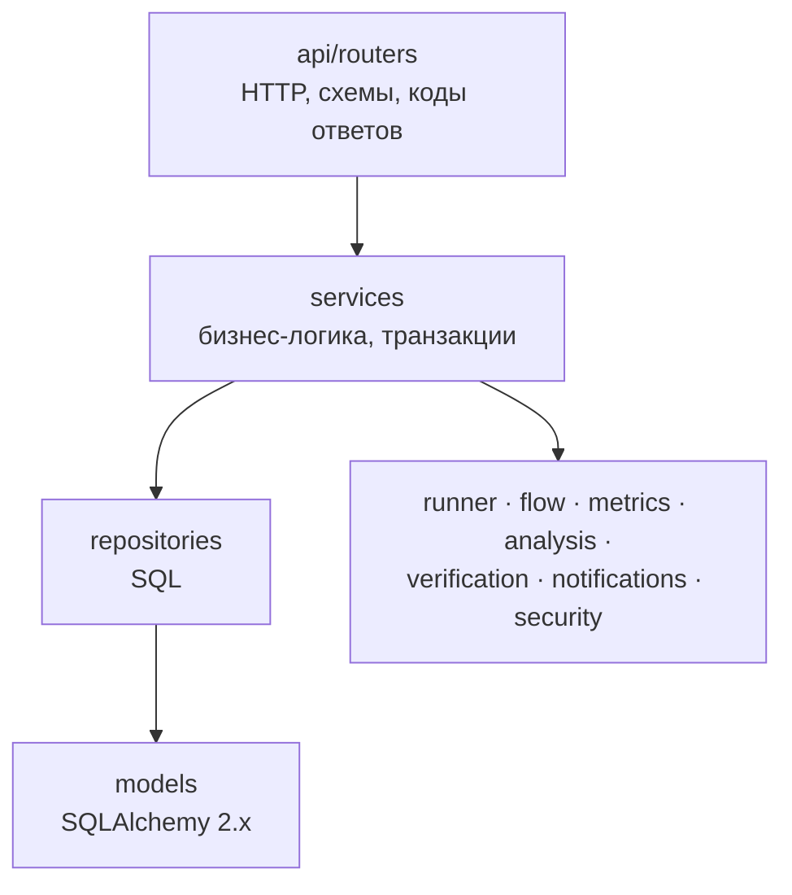
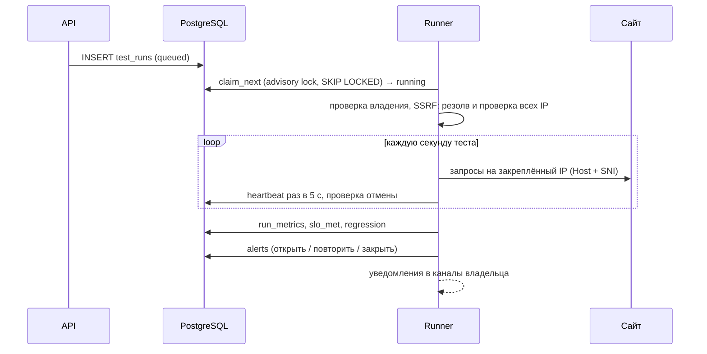
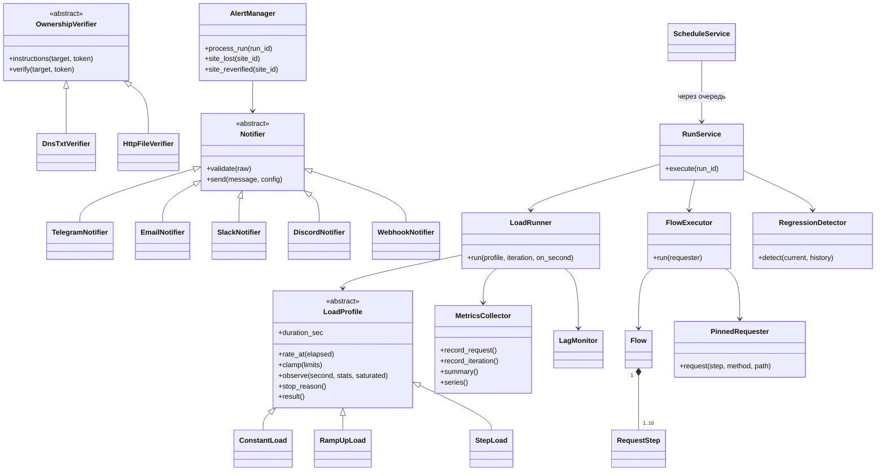
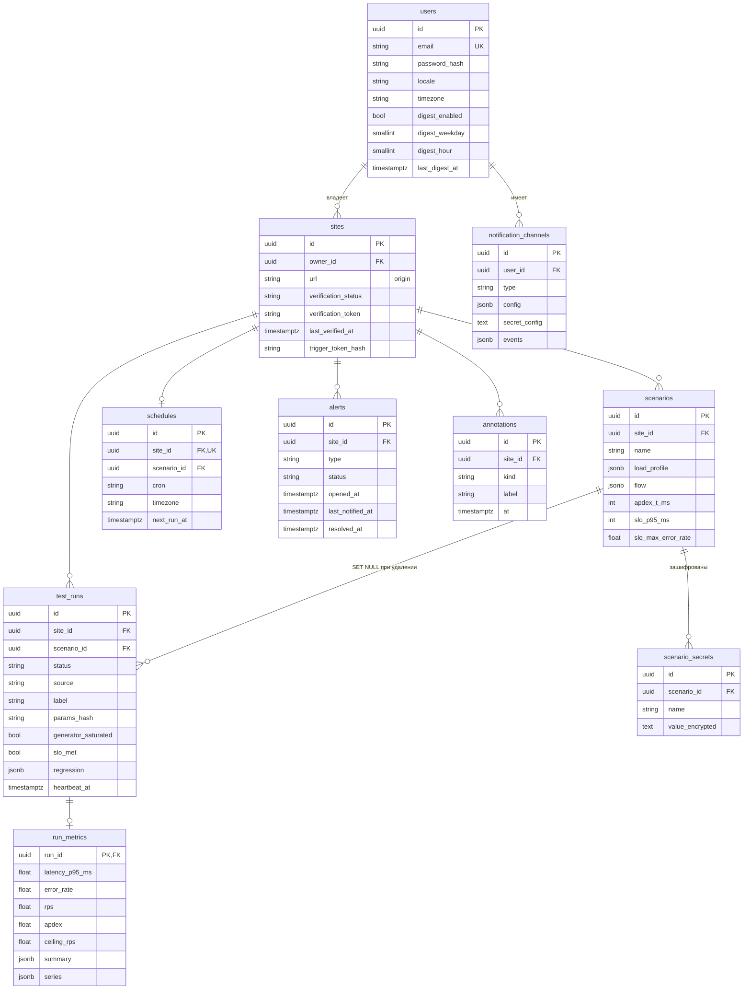

# Архитектура LoadWatch

LoadWatch регулярно нагружает сайты пользователей и следит, не стали ли они медленнее. Сервис состоит из двух процессов и трёх служебных команд. Процессы общаются только через PostgreSQL.

## Процессы

| Компонент | Что делает | Где |
| --- | --- | --- |
| **Web API** | Принимает запросы, проверяет владение сайтом, ставит запуски в очередь (`queued`), отдаёт метрики и отчёты. Тесты не выполняет — кроме лёгкого dry-run одного прохода | `loadwatch/api`, `loadwatch/services` |
| **Runner** | Раз в минуту: переводит зависшие запуски в `failed`, перепроверяет владение, создаёт запуски по расписаниям, выполняет очередь, считает регрессии и SLO, открывает и закрывает алерты | `loadwatch/runner`, `loadwatch/alerts` |
| **Digest** | Раз в час: отправляет еженедельную сводку тем, у кого наступили выбранные день и час | `loadwatch/digest`, `loadwatch/services/digest_service.py` |
| **Maintenance** | Раз в сутки: удаляет посекундные ряды старше `RETENTION_DAYS` | `loadwatch/maintenance.py` |
| **Frontend** | Дашборд в стиле Grafana: Vue 3, Pinia, vue-i18n, Chart.js | `frontend/` |
| **demo_target** | Отдельный демо-сайт для показа: задержки, лимит RPS, логин и защищённая страница | `demo_target/` |

API не хранит состояния между запросами (кроме счётчиков rate limit в памяти), поэтому его можно запускать в несколько воркеров. Runner можно заменить пулом воркеров с очередью: захват запуска уже атомарный (`SELECT … FOR UPDATE SKIP LOCKED` + advisory lock).

## Слои кода

Роутеры не пишут SQL, репозитории не знают про HTTP. Любое изменение схемы — только миграцией Alembic (`migrations/versions`).

## Как выполняется запуск

## Диаграмма классов

Профили, верификаторы и нотификаторы создаются по типу из БД через фабрики/реестры (`profile_from_dict`, `VerifierRegistry`, `NotifierRegistry`).

## ER-диаграмма

Ключевые индексы и ограничения:

- `test_runs(site_id, started_at)` — история и графики;
- `test_runs(status, queued_at)` — очередь;
- частичный уникальный индекс «один активный запуск на сайт» (`status IN ('queued','running')`);
- «один открытый алерт на сайт и тип»;
- `schedules(enabled, next_run_at)`;
- уникальность `(owner_id, url)` у сайтов и `(site_id, name)` у сценариев.

## Почему так

- **Один процесс-генератор и `asyncio`.** На 1 vCPU потоки не помогут, а event loop с `httpx` держит сотни запросов в секунду при ~65 МБ памяти.
- **Потоковые метрики.** Логарифмические корзины с точностью 1% вместо списка задержек: память не зависит от числа запросов.
- **Sync SQLAlchemy.** Генератор во время теста почти не ходит в базу (heartbeat в фоне), поэтому async-драйвер не нужен, а sync-код проще.
- **Время — UTC везде.** Часовой пояс есть только у расписания и в интерфейсе.
